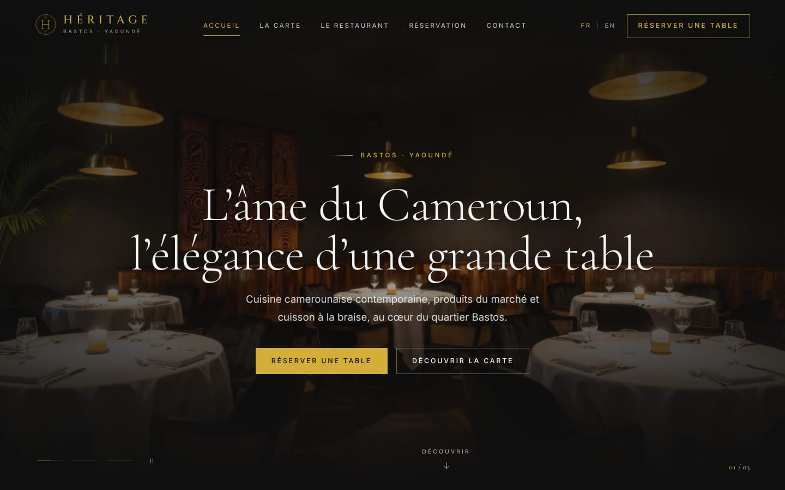
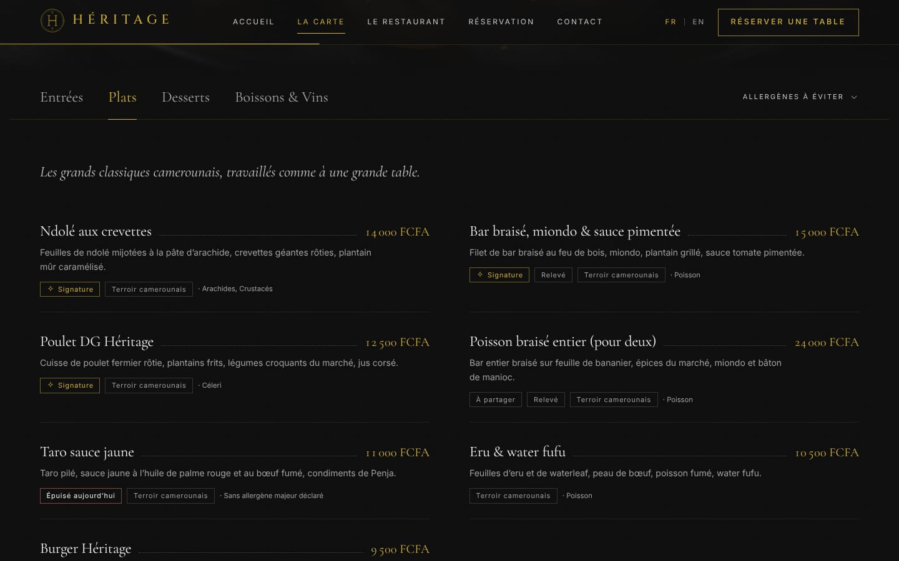
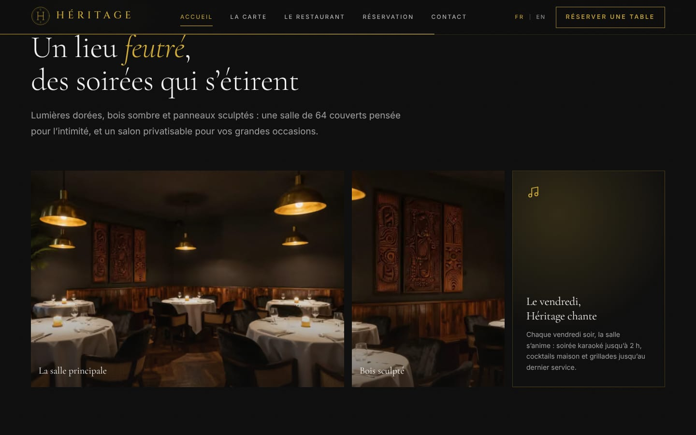
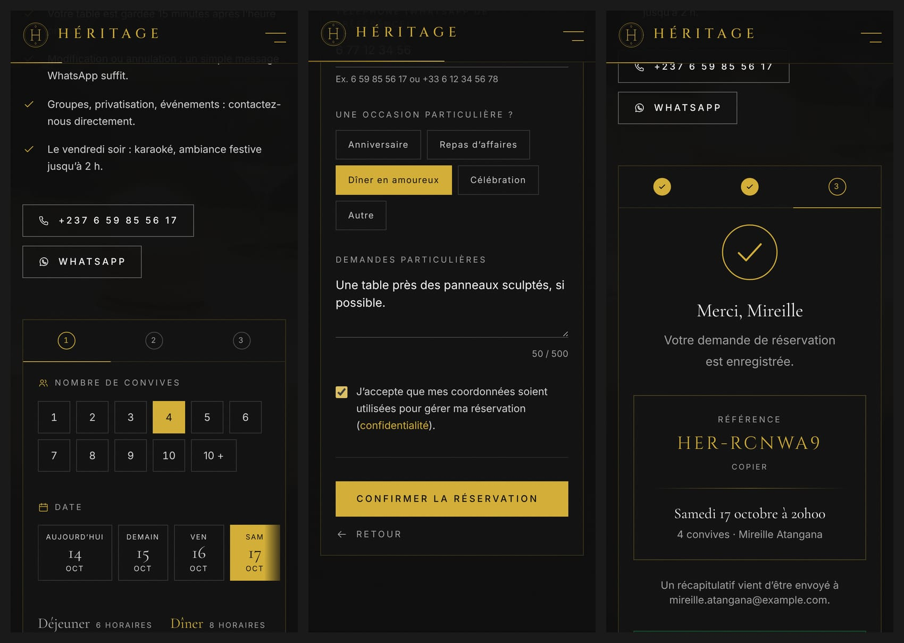
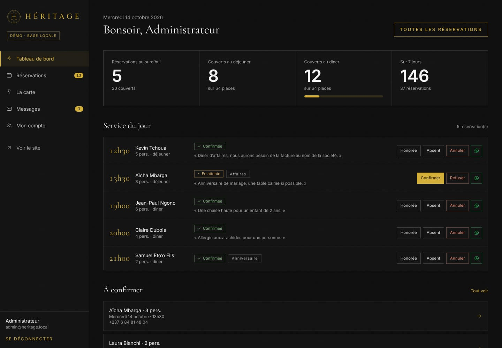
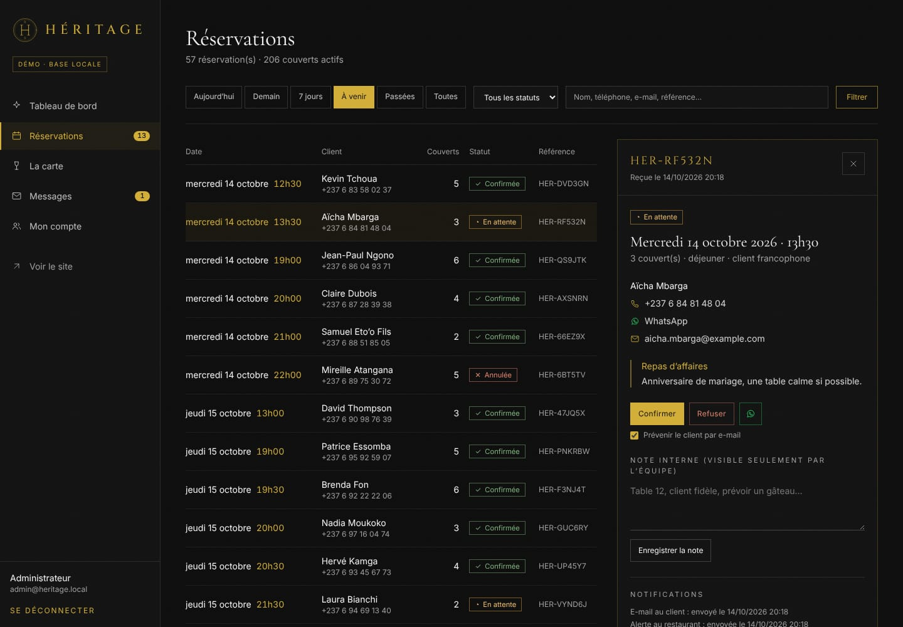
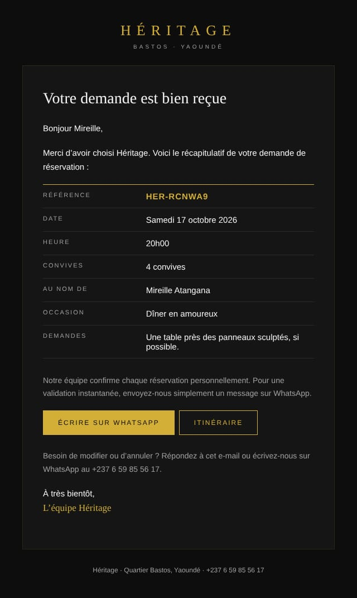

# Héritage — Bastos, Yaoundé

Site vitrine et de réservation haut de gamme du restaurant **Héritage** : cuisine camerounaise contemporaine,
charte sombre et or, entièrement bilingue (français / anglais), avec réservation en ligne multi-canal
(base SQL, e-mails, WhatsApp) et un back-office pour l'équipe.

Refonte du projet `heritage-etape-7` (Node.js / Express / SQLite, archivé dans `heritage-etape-7-main.zip`)
vers **Next.js 16 · React 19 · PostgreSQL**, conformément au cahier des charges.



| La carte (bilingue, lue en base)        | Cadre & ambiance                           |
| --------------------------------------- | ------------------------------------------ |
|  |  |

**Réservation sur téléphone** : choix de la table avec disponibilités en temps réel, coordonnées, confirmation.



| Tableau de bord de l'équipe                   | Fiche réservation                                | E-mail envoyé au client                      |
| --------------------------------------------- | ------------------------------------------------ | -------------------------------------------- |
|  |  |  |

---

## Démarrer en 1 minute

Aucune base de données ni compte e-mail à installer : sans configuration, le site utilise **PGlite**
(un vrai PostgreSQL embarqué, en WebAssembly) et écrit les e-mails dans le dossier `.outbox/`.

```bash
npm install
npm run dev
```

- Site : <http://localhost:3000> (anglais : <http://localhost:3000/en>)
- Administration : <http://localhost:3000/admin> — identifiant et mot de passe **affichés une seule fois dans
  le terminal** au premier démarrage (ou fixés avec `ADMIN_EMAIL` / `ADMIN_PASSWORD` dans `.env.local`).
- La base locale est créée, migrée et remplie automatiquement : carte de démonstration et réservations fictives
  (adresses `example.com`) pour que le tableau de bord ne soit pas vide.
- Les e-mails de réservation sont consultables en ouvrant les fichiers `.outbox/*.html` dans un navigateur.

Node.js 20.9 ou plus récent est requis.

---

## Ce que fait le site

### Côté visiteurs

- **Accueil** : rideau d'ouverture animé (une fois par visite), diaporama plein écran en fondu avec effet
  Ken Burns et parallaxe, section « L'Esprit » en mise en page asymétrique, plats signatures lus en base
  (carrousel au glisser, au clavier ou aux flèches), galerie avec visionneuse plein écran (clavier, glisser),
  module de réservation, bandeau défilant « Réserver une table ».
- **La Carte** : onglets animés (motif ARIA « tabs », flèches du clavier), prix en FCFA, allergènes et
  spécificités, plats épuisés signalés, **filtre « allergènes à éviter »**, version imprimable, lien direct vers
  une catégorie (`/la-carte#plats`).
- **Réservation** en 3 étapes : convives, date (bande des 14 prochains jours + calendrier), créneaux du
  déjeuner et du dîner avec **places restantes en temps réel** (« Dernières places », « Complet »), coordonnées
  avec validation instantanée, occasion, demandes particulières. Confirmation avec référence (`HER-XXXXXX`),
  **message WhatsApp pré-rempli** pour une validation instantanée et **ajout à l'agenda** (.ics).
  Groupes de plus de 10 personnes orientés vers WhatsApp.
- **Le Restaurant**, **Contact** (formulaire enregistré en base + alerte e-mail, carte Google Maps chargée au
  clic pour la vie privée), **mentions légales et confidentialité**, page 404 de marque.
- En-tête collant transparent puis opaque au défilement (avec barre de progression), menu plein écran sur
  téléphone, **bascule FR / EN instantanée** sur la même page et à la même position, URL traduites
  (`/la-carte` ↔ `/en/menu`, `/reservation` ↔ `/en/book-a-table`).
- Statut « Ouvert · ferme à 23h00 » calculé à l'heure de Yaoundé, y compris les soirées qui finissent après minuit.

### Côté équipe (`/admin`)

- **Tableau de bord** : réservations et couverts du jour, remplissage du dîner, service du jour minute par
  minute, demandes à confirmer, graphique des couverts sur 14 jours (avec info-bulles et vue tableau).
- **Réservations** : filtres (aujourd'hui, demain, 7 jours, à venir, passées), recherche, fiche détaillée,
  confirmation / refus / annulation **avec e-mail automatique au client**, honorée / absent, note interne,
  lien WhatsApp vers le client pré-rempli dans sa langue, état des notifications et renvoi, aperçu de l'e-mail.
- **La carte** : ajout, modification bilingue, prix, photo, allergènes, spécificités, disponible / épuisé,
  signature, ordre d'affichage, catégories. **Chaque modification met à jour le site public immédiatement.**
- **Messages** du formulaire de contact, **Mon compte** (mot de passe, configuration active).

### Le parcours d'une réservation

1. Le visiteur choisit son créneau : les places restantes viennent de `GET /api/availability`.
2. La Server Action `submitReservation` revalide tout côté serveur (le navigateur n'est jamais cru), puis
   enregistre la réservation dans une **transaction PostgreSQL verrouillée par date** : deux clients ne peuvent
   pas obtenir la dernière table du même créneau (testé avec des demandes simultanées).
3. Après la réponse, l'**e-mail de confirmation au client** (dans sa langue) et l'**alerte à l'établissement**
   partent en arrière-plan ; un échec est noté et retenté automatiquement (sans jamais perdre la réservation).
4. Le client reçoit un **lien WhatsApp pré-rempli** vers le numéro officiel pour une validation instantanée.
   Option : alerte WhatsApp automatique au restaurant via l'API Twilio.
5. L'équipe confirme depuis `/admin` : le client reçoit l'e-mail « Votre table vous attend ».

---

## Couverture du cahier des charges

| Exigence                                                                              | Réalisation                                                                                                                                                                      |
| ------------------------------------------------------------------------------------- | -------------------------------------------------------------------------------------------------------------------------------------------------------------------------------- |
| Front-end React / App Router Next.js                                                  | Next.js 16.3 (App Router, Turbopack), React 19, TypeScript strict                                                                                                                |
| Back-end API Routes / Server Actions                                                  | Server Actions (réservation, contact, administration) + routes `/api/availability`, `/api/health`, `/api/cron/notifications`                                                     |
| Base SQL (menu, catégories, réservations)                                             | PostgreSQL via Drizzle ORM : `categories`, `dishes`, traductions, `reservations`, contact, admin, limitation de débit — migrations SQL versionnées dans `drizzle/`               |
| Tailwind CSS + Framer Motion                                                          | Tailwind CSS 4 (charte en variables `@theme`) et Motion (nouveau nom de Framer Motion)                                                                                           |
| Multilingue FR / EN avec sélecteur                                                    | next-intl : URL traduites, bascule instantanée, hreflang, e-mails dans la langue du client                                                                                       |
| Notification e-mail (Resend / Nodemailer)                                             | Les deux : Resend si `RESEND_API_KEY`, sinon SMTP (Nodemailer), sinon aperçu local                                                                                               |
| WhatsApp (Twilio ou lien pré-rempli)                                                  | Les deux : lien `wa.me` pré-rempli + alerte Twilio facultative                                                                                                                   |
| Palette #0D0D0D / #121212, or #D4AF37, #F5F5F5 / #A0A0A0                              | Respectée ; contrastes vérifiés par des tests (or sur fond : 9,2:1)                                                                                                              |
| Typographies serif + sans-serif                                                       | Cormorant Garamond (titres), Cinzel (logo), Inter (texte), auto-hébergées par `next/font`                                                                                        |
| Animations au défilement, parallaxe                                                   | Apparitions au défilement, parallaxe, Ken Burns, transitions de pages ; « réduire les animations » respecté                                                                      |
| Header : logo or, menu, FR/EN, CTA doré, sticky transparent → opaque                  | Oui (+ barre de progression de lecture, menu mobile plein écran)                                                                                                                 |
| Accueil : Hero, L'Esprit, Aperçu carte (SQL), Ambiance, Réservation, Footer complet   | Oui, dans cet ordre ; footer avec horaires, adresse, Google Maps, réseaux, mentions légales                                                                                      |
| Carte : catégories, onglets, nom, description, allergènes, tarif, traductions en base | Oui (+ filtre d'allergènes, impression, plats épuisés)                                                                                                                           |
| Formulaire : date, heure, convives, nom, prénom, e-mail, téléphone, demandes          | Oui (+ occasion, consentement, champ piège anti-robot)                                                                                                                           |
| Workflow : base → e-mails → WhatsApp                                                  | Oui, avec relance automatique des e-mails en échec                                                                                                                               |
| Responsive mobile / tablette / desktop                                                | Oui ; absence de débordement horizontal testée sur téléphone                                                                                                                     |
| SEO : `<Image/>`, OpenGraph, Schema.org (Restaurant, Menu)                            | Images optimisées AVIF/WebP avec aperçu flou, image de partage générée par langue (55 Ko, compatible WhatsApp), `Restaurant` + `ReserveAction`, `Menu`, sitemap bilingue, robots |
| Accessibilité / contrastes                                                            | Audit automatique axe (WCAG 2.1 AA) sans violation sur 7 pages, navigation clavier, lecteurs d'écran                                                                             |
| Mise en production Vercel / serveur Node                                              | `vercel.json` + script `vercel-build`, `Dockerfile`, `docker-compose.yml`                                                                                                        |

---

## Configuration

Toutes les variables sont décrites dans [`.env.example`](.env.example) (à copier en `.env.local`).
Les principales :

| Variable                        | Rôle                                                       |
| ------------------------------- | ---------------------------------------------------------- |
| `DATABASE_URL`                  | PostgreSQL de production (sinon PGlite local)              |
| `NEXT_PUBLIC_SITE_URL`          | URL publique (canoniques, OpenGraph, liens des e-mails)    |
| `RESTAURANT_EMAIL`, `MAIL_FROM` | Destinataire des alertes, expéditeur                       |
| `RESEND_API_KEY` ou `SMTP_*`    | Envoi réel des e-mails                                     |
| `NEXT_PUBLIC_WHATSAPP_NUMBER`   | Numéro WhatsApp officiel (par défaut +237 6 59 85 56 17)   |
| `TWILIO_*`                      | Alerte WhatsApp automatique (facultatif)                   |
| `RESERVATION_AUTO_CONFIRM`      | `true` pour confirmer sans intervention de l'équipe        |
| `AUTH_SECRET`, `CRON_SECRET`    | Sel des empreintes IP, protection de la tâche planifiée    |
| `NEXT_PUBLIC_INSTAGRAM_URL`…    | Réseaux sociaux (affichés seulement s'ils sont renseignés) |

Les horaires, services, capacités (64 couverts, 24 nouveaux couverts par créneau), délais et coordonnées sont
centralisés dans [`src/lib/restaurant.ts`](src/lib/restaurant.ts) : une seule source pour le site, les
microdonnées, les e-mails et le calcul des créneaux.

## Mise en ligne

**Vercel + Neon (recommandé)**

1. Créer une base PostgreSQL (Neon, Supabase ou Vercel Postgres), région Europe de l'Ouest.
2. Importer le dépôt sur Vercel, renseigner `DATABASE_URL`, `NEXT_PUBLIC_SITE_URL`, `RESTAURANT_EMAIL`,
   `MAIL_FROM`, `RESEND_API_KEY`, `AUTH_SECRET`, `CRON_SECRET`.
3. Déployer : le script `vercel-build` applique les migrations et la carte de départ avant le build.
4. Créer le compte de l'équipe (une fois, depuis votre poste) :
   `DATABASE_URL=… npm run admin:create -- --email chef@heritage-bastos.cm --name "Chef"`

La tâche planifiée de `vercel.json` relance chaque jour les e-mails en échec (les relances ont aussi lieu à
chaque nouvelle réservation).

**Render** : le blueprint `render.yaml` crée le site et sa base PostgreSQL (Francfort). Au démarrage,
`npm run db:setup` applique les migrations, ajoute la carte de départ et crée le compte de l'équipe à partir
de `ADMIN_EMAIL` / `ADMIN_PASSWORD` (12 caractères minimum) s'il n'existe pas encore. `DATABASE_URL` y est
obligatoire : PGlite consomme environ 600 Mo, au-delà des 512 Mo de l'offre gratuite. Sur l'offre gratuite,
le site se met en veille après 15 min sans visite (premier affichage plus lent) et la base expire au bout
de 30 jours sauf passage à une offre payante.

**Serveur Node / Docker** : `docker compose --profile app up --build` (site + PostgreSQL), ou
`npm run build && npm run db:setup && npm start` sur n'importe quel serveur Node.js.

## Commandes

| Commande                                                | Rôle                                                                                  |
| ------------------------------------------------------- | ------------------------------------------------------------------------------------- |
| `npm run dev`                                           | Développement (base locale automatique)                                               |
| `npm run build` / `npm start`                           | Build et serveur de production                                                        |
| `npm run lint` · `npm run typecheck` · `npm run format` | Qualité du code                                                                       |
| `npm test`                                              | Tests unitaires et d'intégration (66 tests, base PGlite en mémoire ou `DATABASE_URL`) |
| `npm run test:e2e`                                      | Tests de bout en bout Playwright, audit d'accessibilité axe (après `npm run build`)   |
| `npm run db:generate`                                   | Générer une migration après modification de `src/lib/db/schema.ts`                    |
| `npm run db:setup`                                      | Appliquer les migrations et la carte de départ (idempotent)                           |
| `npm run admin:create -- --email …`                     | Créer le compte admin ou réinitialiser son mot de passe                               |
| `npm run images:optimize`                               | Préparer les vraies photos du restaurant (voir ci-dessous)                            |

La CI GitHub Actions (`.github/workflows/ci.yml`) lance le lint, le typage, les tests sur PGlite **et** sur un
vrai PostgreSQL 16, puis les tests de bout en bout.

## Remplacer les photos

Les visuels actuels sont des **illustrations générées pour la démonstration** (signalé dans le pied de page et
les mentions légales). Pour mettre les vraies photos :

1. Déposer les originaux dans `photos-originales/hero`, `photos-originales/plats`, `photos-originales/ambiance`.
2. `npm run images:optimize` : redimensionnement, WebP, suppression des métadonnées GPS.
3. Déclarer les images dans `src/lib/images.ts` ; elles deviennent sélectionnables dans `/admin/carte`.

## Architecture

```
src/
├── app/
│   ├── [locale]/            pages publiques bilingues (accueil, la-carte, le-restaurant, reservation, contact…)
│   ├── admin/               back-office (connexion, tableau de bord, réservations, carte, messages, compte)
│   ├── actions/             Server Actions publiques (réservation, contact)
│   ├── api/                 disponibilités, santé, tâche planifiée
│   └── sitemap.ts, robots.ts, manifest.ts, icon.svg, global-not-found.tsx
├── components/              layout, home, booking, menu, contact, admin, ui
├── i18n/                    routage et URL traduites (next-intl)
├── lib/
│   ├── db/                  schéma Drizzle, connexion PostgreSQL / PGlite, données de départ
│   ├── reservations/        créneaux et capacités (fonctions pures), validation, service SQL, notifications, .ics
│   ├── email/               envoi (Resend / SMTP / aperçu) et modèles HTML
│   ├── auth/                mots de passe bcrypt, sessions
│   └── restaurant.ts        informations et règles du restaurant (source unique)
├── proxy.ts                 langue et protection de /admin
messages/fr.json, en.json    textes du site (mêmes clés, vérifié par les tests)
drizzle/                     migrations SQL
tests/                       unitaires, intégration (SQL réel), bout en bout (Playwright)
```

## Sécurité

Résumé dans [`SECURITY.md`](SECURITY.md) : requêtes paramétrées, validation serveur systématique,
protection CSRF des Server Actions, sessions à jeton haché, bcrypt, limitation de débit en base, CSP et
en-têtes de sécurité, échappement des e-mails, aucun secret dans le code.

## À compléter avant l'ouverture au public

- Vraies photos, adresse exacte et position sur la carte, liens des réseaux sociaux, e-mail public.
- Horaires définitifs et capacités dans `src/lib/restaurant.ts`.
- Informations de l'hébergeur dans les mentions légales ; durée de conservation des données à valider.
- Domaine d'envoi vérifié chez Resend (ou compte SMTP) et, si souhaité, modèle WhatsApp approuvé chez Twilio.
